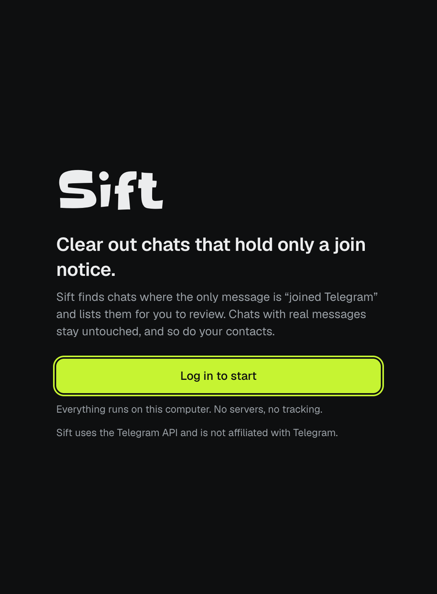
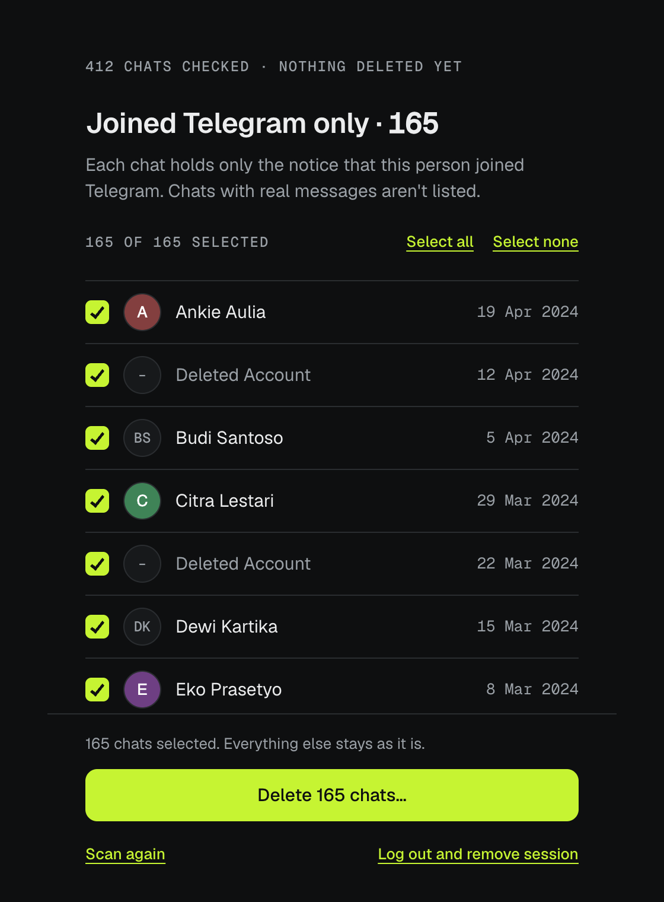
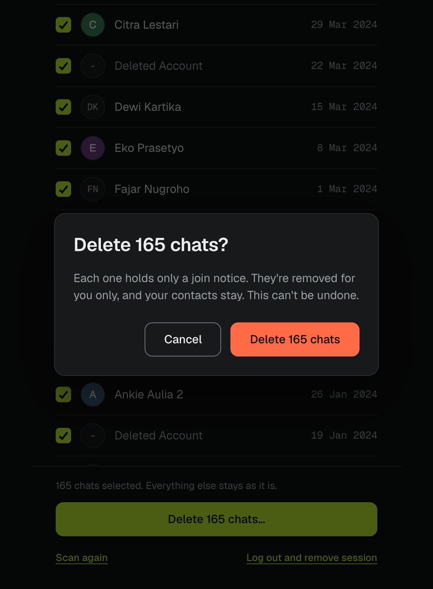
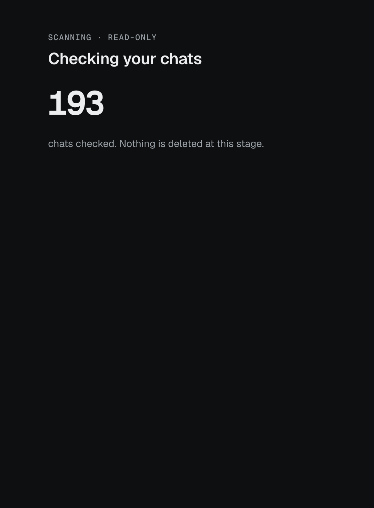
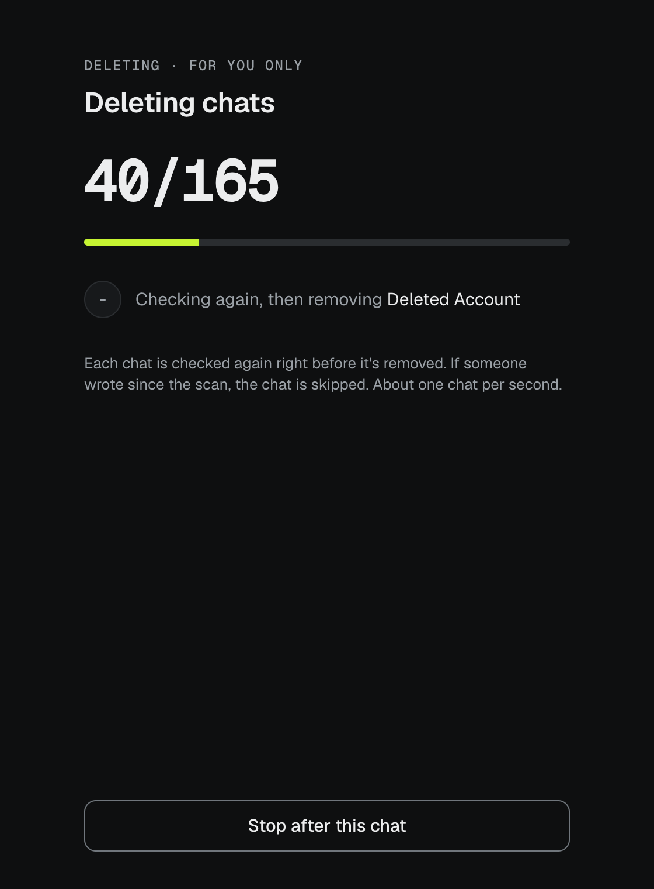
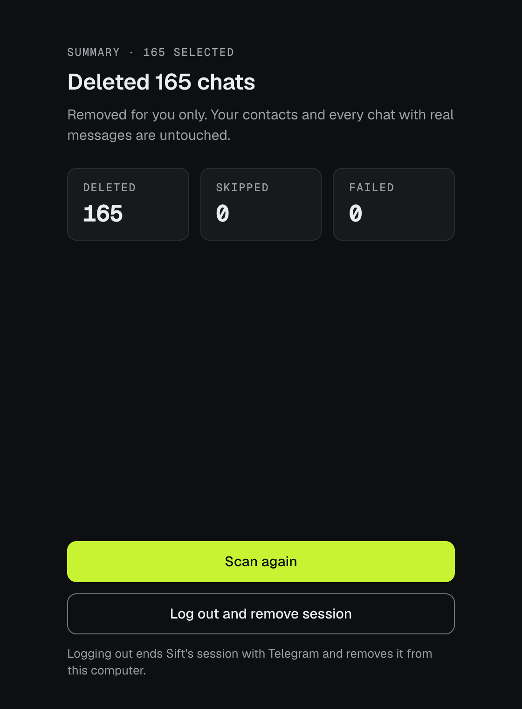

  

<h1 align="center">Sift</h1>

  <strong>Clear out the Telegram chats that hold only a "joined Telegram" notice.</strong> 
  Real conversations stay untouched, and so do your contacts.

  
  

  Free and open source (MIT) · macOS 12+ and Windows 10+ · Sift uses the Telegram API and is not affiliated with Telegram.

 

<table>
  <tr>
    <td align="center" width="33%">
      <picture>
        <source media="(prefers-color-scheme: light)" srcset="docs/screenshots/light-1-intro.png">
        
      </picture>
       <b>1.</b> Log in once
    </td>
    <td align="center" width="33%">
      <picture>
        <source media="(prefers-color-scheme: light)" srcset="docs/screenshots/light-3-results.png">
        
      </picture>
       <b>2.</b> Review what it found
    </td>
    <td align="center" width="33%">
      <picture>
        <source media="(prefers-color-scheme: light)" srcset="docs/screenshots/light-4-confirm.png">
        
      </picture>
       <b>3.</b> Confirm, knowing what stays
    </td>
  </tr>
  <tr>
    <td align="center">
      <picture>
        <source media="(prefers-color-scheme: light)" srcset="docs/screenshots/light-2-scan.png">
        
      </picture>
       The scan only reads
    </td>
    <td align="center">
      <picture>
        <source media="(prefers-color-scheme: light)" srcset="docs/screenshots/light-5-deleting.png">
        
      </picture>
       Each chat is checked again first
    </td>
    <td align="center">
      <picture>
        <source media="(prefers-color-scheme: light)" srcset="docs/screenshots/light-6-summary.png">
        
      </picture>
       A clear summary at the end
    </td>
  </tr>
</table>

Screenshots use sample data. They follow your GitHub theme; the app follows your system's light or dark setting.

## Why

Each time someone in your contacts joins Telegram, a new chat appears holding a single line: *"joined Telegram"*. Hundreds of these can pile up between your real conversations, and clearing them one at a time takes a long time.

Sift finds them, shows them to you, and removes the ones you choose.

## What it does, and what it doesn't

- **Lists only exact matches.** A chat qualifies only when its one and only message is Telegram's join notice. Sift checks the message *type*, not its text, so a chat where anyone has written a word is never listed.
- **Reads before it removes.** The scan is read-only. Nothing changes until you review the list and confirm.
- **Lets you choose.** Every chat starts selected, and you can untick any you want to keep.
- **Checks again before each delete.** If someone wrote after the scan, that chat is skipped and reported.
- **Removes for you only.** The other person's copy stays, and your contacts aren't touched.
- **Respects Telegram's limits.** About one chat per second. If Telegram asks Sift to wait, you see a countdown and it carries on by itself.
- **Includes deleted accounts.** Join-notice chats from accounts that were later deleted are listed as "Deleted Account".
- **Skips everything else.** Groups, channels, bots and Saved Messages are never listed.

## Privacy

- **Everything runs on your computer.** Sift has no servers, no accounts, no analytics and no tracking. It only talks to Telegram.
- **Your login stays in your system's secure storage**: Keychain on macOS, Credential Manager on Windows. Your password is never saved.
- **"Log out and remove session"** ends Sift's session with Telegram and deletes it from your computer.
- **The code is open.** You can read exactly what Sift does in [`src-tauri/src/telegram.rs`](src-tauri/src/telegram.rs) and [`detect.rs`](src-tauri/src/detect.rs).

## Install

Download the latest version from **[Releases](https://github.com/hystericmoon/sift/releases/latest)**.

**macOS 12 or later** (Apple Silicon and Intel)
1. Download `Sift_x.y.z_universal.dmg` and open it.
2. Drag **Sift** into **Applications**.
3. Sift isn't code-signed yet. If macOS blocks the first launch, open **System Settings → Privacy & Security** and click **Open Anyway**.

**Windows 10 or later**
1. Download `Sift_x.y.z_x64-setup.exe` and run it. No admin rights are needed.
2. Sift isn't code-signed yet. If SmartScreen appears, click **More info → Run anyway**.

**To uninstall**, first choose **Log out and remove session** in Sift, then remove the app as usual.

## FAQ

**Will the other person notice?**
No. The chat is removed from your side only. Nothing is sent to them.

**Will I lose contacts?**
No. Sift only removes the chat; your contact list isn't touched.

**What if I change my mind halfway?**
Press **Stop after this chat** at any time. The summary shows exactly what was removed, and the rest stays as it was.

**Can it undo a delete?**
No, and the confirm step says so. Removed chats can't be brought back. Since each one held only a join notice, nothing else is lost.

**Why do I log in with my phone number?**
Sift talks to Telegram directly, the same way Telegram's own apps do, so it needs to log in to your account. The login code arrives in your Telegram app, and if you use two-step verification, Sift asks for that password too.

## Built with

[Tauri 2](https://tauri.app) (Rust) · [grammers](https://codeberg.org/Lonami/grammers) for Telegram's MTProto protocol · React and TypeScript · [Geist](https://vercel.com/font) and [Slackey](https://fonts.google.com/specimen/Slackey) fonts. The macOS download is about 5 MB.

Want to build it yourself or contribute? See **[docs/DEVELOPMENT.md](docs/DEVELOPMENT.md)**. Project status and open items: [docs/HANDOFF.md](docs/HANDOFF.md).

## License

[MIT](LICENSE) © 2026 Hosni Rachmani

Sift uses the Telegram API and is not affiliated with Telegram.
